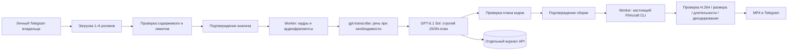

# Filmcraft в «Образе»: закрытый тест владельца

24.11.2026. Дополнение к [основному ТЗ](PRD.md), контракт
[CR-TG-FILMCRAFT-001](changes/CR-TG-FILMCRAFT-001.md).

## Как проверить

Только ваш личный Telegram-аккаунт **3975497**, бот **@obraz_photo_bot**.
Напишите **«Хочу сделать видео»** или **/filmcraft**. Ещё один вход:
**/admin → Сделать видео · Filmcraft**. В общий пользовательский интерфейс
и в MAX этот эксперимент не добавлен.

1. Отправьте от одного до шести роликов, по одному или альбомом.
   Каждый до **19 MB**, все вместе до **90 секунд**, разрешение до 4K.
   Если оригинал с iPhone больше лимита, отправьте его как видео с уменьшением
   размера в Telegram. Это ограничение скачивания через обычный Telegram Bot API.
2. Напишите пожелание до или после загрузки. Например:
   «Собери вертикальный ролик до 30 секунд. Сохрани речь, добавь русский
   заголовок и субтитры. Начни со второго ролика».
3. При желании приложите свою музыку MP3/M4A/WAV до 5 MB.
   Если распознавание речи не нужно, выключите его кнопкой.
4. Напишите **«готово»**. Проверьте материалы и подтвердите **платный анализ**.
   До этого подтверждения вызовов OpenAI нет.
5. Бот покажет план: порядок роликов, интервалы, формат, звук и субтитры.
   Нажмите **«Собрать MP4»**. Изменение пожеланий требует отдельного нового
   подтверждения анализа; повторная сборка текущего плана модель не вызывает.
6. Получите видео и при необходимости откройте **«Расходы»**:
   сообщение и JSON с фактически возвращёнными токенами, моделями,
   request ID, состояниями запросов и длительностью отправленного аудио.
   Отсутствующие данные расхода помечаются как неизвестные, а не нулевые.

«Завершить видеорежим», обычные команды и переходы в меню освобождают
диалог для фотографий. /filmcraft позволяет вернуться к последней работе;
«Новая работа» начинает подбор заново. Нельзя параллельно запустить старый
FFmpeg-монтаж и новый Filmcraft-монтаж.

## Что именно делает система

Filmcraft **v0.20.1**, release commit
`cedf0c9bd060eb06a977d532402be2097c9ebe42`.
Linux-архив проверен по SHA-256
`3e4fea3cb8d473e68f189a0a8792ba46160fab507adab3ab8920073fd41f24fa`;
CLI — `2fbc2865ee89f345b06747d7275d82274c740b4d7b42e16583ed534fdd69d7e9`.

Модель выбирает **1–8 целых фрагментов** из максимум 12 подготовленных сегментов,
анализируя выборочные кадры и речь. Это монтажная схема с приблизительной
синхронизацией субтитров. Она не смотрит непрерывно каждый кадр и не гарантирует
точный выбор короткого движения. Результат — H.264 MP4, **720p, до 60 секунд**,
9:16 / 16:9 / 1:1. Полный кадр вписывается с полями. Доступны русский титр,
прямые склейки / затемнение краёв, исходный звук / тишина / своя тихая музыка.
Новые видеосцены и музыка не генерируются.

Filmcraft собирает видео, графику и субтитры. FFmpeg подготавливает кадры/аудио,
добавляет пользовательскую музыку и faststart, независимо проверяет результат.
Скрытой подмены на старый FFmpeg-only монтаж при ошибке нет.

## Расход и хранение

Фотобаланс не меняется. Подтверждённый анализ расходует собственный OpenAI-баланс:
один запрос GPT-6.1 Sol и до 12 запросов распознавания речи. Фактический расход
виден после теста, заранее фиксированная стоимость не обещается.
Кадры и речь передаются OpenAI после подтверждения; план запрашивается с store=false.
При сетевой неопределённости повтор не выполняется автоматически.

Исходные материалы, результат и содержимое работы на VPS удаляются через 24 часа;
технический журнал API остаётся отдельно. Это срок хранения на нашем сервере,
он не описывает сроки Telegram и OpenAI. Новые данные не смешиваются с финансовыми
таблицами или старым журналом видео.

## Размещение и откат

- Worker: служба `obraz-filmcraft`, отдельный пользователь без ключей и сети.
- Один монтаж одновременно; CPU до одного из двух ядер, Nice=10,
  MemoryHigh=448 MiB, MemoryMax=512 MiB, TasksMax=64.
- Подготовка отклоняется при менее 650000 KiB доступной RAM либо 1 GB диска.
- Приватный spool: `/var/lib/obraz-filmcraft`, отдельный журнал:
  `/var/lib/image-studio-bot/live-pilot/filmcraft-video/usage.sqlite3`.
- Новые настройки: `/etc/image-studio-filmcraft.env` и отдельный systemd drop-in.
  Исходный `/etc/image-studio-bot.env` сохраняется побайтно.
- Аварийное отключение: в новом override поставить `FILMCRAFT_ENABLED=false`
  и перезапустить только `image-studio-bot`. После завершения/отмены текущей работы
  можно остановить worker. Не восстанавливать старую финансовую БД поверх новых оплат.

Настоящий синтетический серверный монтаж: два клипа, 2.4 секунды результата,
музыка + русский титр + субтитры, 720×1280. Независимое декодирование прошло.
Пиковая память cgroup 462516224 байта (около 441 MiB), OOM/restarts=0.
Первый запуск занял 92.351 секунды, включая настройку мягкого порога памяти;
он выполнялся при CPUQuota=50%, финальная конфигурация — 100% одного ядра.
Это проверка работоспособности, не обещание скорости для роликов с iPhone.
Длинный монтаж на текущем VPS может занимать несколько минут.

Реальные пользовательские HEVC/HDR-ролики и качество монтажных решений модели
проверяются владельцем в закрытом тесте. Автоматические проверки не тратят API.

Источники: [Filmcraft](https://github.com/storytold/filmcraft/releases/tag/v0.20.1),
[Telegram: получение файлов](https://core.telegram.org/bots/api#getfile),
[OpenAI: Structured Outputs](https://developers.openai.com/api/docs/guides/structured-outputs),
[systemd: ограничения ресурсов](https://www.freedesktop.org/software/systemd/man/latest/systemd.resource-control.html).
