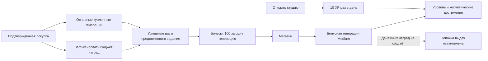

# «Образ»: первоначальные варианты XP, заданий и магазина

Дата: 24.10.2026. Изменение: **CR-GAMIFICATION-001**. Статус: **предложение и расчёт; не внедрено**.

**Архив первой редакции.** Последующим уточнением владельца выбрана общая награда550 бонусов, заменяющая рекомендацию150 и потолок10%. Актуальная механика, граф, комплектование заданий и экономика — [CR-GAMIFICATION-002](gamification-scenario-generator-2026-10-24.md). Ниже сохранены первоначальные варианты для сравнения; это не действующие лимиты бота. JSON/CSV дополнены текущим сценарием550, его чувствительностью и покрытием расходов.

Уточнение владельца 24.10: текущий этап — бета-тестирование, фиксированной цели прибыли нет. Трём основным тестерам уже выдано по50 генераций за обратную связь; бюджет этих150 результатов — в [отдельном расчёте](beta-testing-budget-2026-10-24.md). Это выдача владельца, не запущенная игровая программа.

Основное ТЗ остаётся в [PRD.md](PRD.md). Здесь — проект геймификации и условия её экономической устойчивости. Telegram, MAX, цены, остатки, регулярные подарки и уведомления не изменялись. Платных модельных вызовов для исследования нет. Подготовлено по `process-design-vibecoding`; имеющиеся требования не переоткрываются.

## 1. Решение, которое предлагаю

Сделать небольшой игровой слой вокруг полезных действий в фотостудии: **XP → уровни; задания → бонусы; бонусы → генерации**. Человек примеряет одежду, подбирает фон, видит результат и получает понятную награду. Награда помогает познакомиться с функциями, а не требует бессмысленно повторять обработку.

Начать с **одного разового комбо «Собери образ»**: одежда → подходящий фон. После первого успешного шага начислить 50 бонусов, после второго ещё 100; всего **150 бонусов**, а не 50 + 150. Это одна генерация и ещё половина стоимости следующей в бонусах. Разовое комбо доступно после первой настоящей покупки и только один раз на аккаунт в пилоте. Повторная покупка не обновляет его.

Для следующего этапа рассмотреть общий предел наград **10% от числа генераций в оплаченном пакете**, включая разовое комбо внутри этого предела. Получится максимум 2 / 5 / 7,5 дополнительных генерации для Express / Базового / Premium. Это отдельная гипотеза расширения, а не дополнительный подарок поверх пилота.

**Постоянную выдачу 0,5 генерации за каждую или 1,5 за любые две не рекомендую.** На больших пакетах второй вариант даёт отрицательный вклад при плановой себестоимости 4 ₽ и резерве удержаний 30%. Разовая яркая награда с ограниченным общим бюджетом сохраняет идею пользователя и обходится значительно дешевле.

Гарантировать прибыль при неизвестных комиссиях, привлечении и реальном потреблении нельзя. Ниже указаны конкретные границы, при которых предложение работает.

## 2. Что проверено, что принято за допущение

### Действующий продукт

Каталог прочитан из `src/image_studio/pricing.py`. В стоимость больших пакетов **уже включены** прежние бонусы: повторно добавлять их в расчёт нельзя.

| Пакет | Цена | Основные + существующий бонус | Всего | Цена одной включённой генерации |
|---|---:|---:|---:|---:|
| Express | 240 ₽ | 20 + 0 | 20 | 12 ₽ |
| Базовый | 480 ₽ | 40 + 10 | 50 | 9,60 ₽ |
| Premium | 720 ₽ | 60 + 15 | 75 | 9,60 ₽ |

На VPS через SSH проверены только агрегаты SQLite в режиме чтения и разрешённые поля конфигурации. Обе платформы настроены на `gpt-image-2.5-sunburst-2026-09-08`, `medium`. Окно выборки: с 22.10.2026 00:00 UTC; владелец и задания с безлимитным доступом исключены. Финальный срез: 23.10.2026 19:39 UTC, уже 24 октября по времени пользователя.

| Платформа / функция | Успешных результатов с полным usage | Пересчитанная стоимость Image API при 100 ₽/$ |
|---|---:|---:|
| Telegram / причёска | 1 | 2,5806 ₽ |
| MAX / фон | 1 | 2,5326 ₽ |
| MAX / одежда | 1 | 2,5261 ₽ |
| MAX / фото на документы | 1 | 2,5861 ₽ |
| **Итого / среднее** | **4** | **2,55635 ₽** |

Все четыре задания доставлены, пропусков usage в этом окне нет, дополнительного анализа референса в них нет. **Четыре результата не доказывают среднюю или предельную себестоимость всей студии.** Модель и качество не записываются в каждое обычное задание, поэтому конфигурация и время после релиза — косвенное подтверждение модели, не точная квитанция каждого вызова. Это пересчёт токенов, не сверка списания с итоговым счётом OpenAI. Прежняя выборка Flare не смешана с новой.

[Официальные ставки OpenAI](https://developers.openai.com/api/docs/pricing#image-generation), проверены 24.10: Standard — $5 за миллион текстовых входных токенов, $8 за миллион входных image-токенов, $30 за миллион выходных image-токенов. [Документация рекомендует измерять `usage`](https://developers.openai.com/api/docs/guides/image-generation#cost-and-latency): одинаковые ставки не означают одинаковую стоимость результата. Кэш для текущего прямого Images API в оценку не заложен; Batch для интерактивной очереди не предполагается.

### Допущения расчёта

| Параметр | Принято здесь | Статус |
|---|---|---|
| Рабочий режим | Sunburst Medium, 1024×1024, один итоговый файл | Текущий режим проекта; качество подарка такое же |
| Цена пополнения | 100 ₽ за $1 | Плановое допущение; не курс ЦБ и не проверенная цена пополнения |
| Бюджет одного результата `c` | **4 ₽**, чувствительность 2,56 / 6 / 8 ₽ | Плановый запас; не гарантированный потолок |
| Удержания `d` | **30% выручки**, дополнительно сценарии 10% и 20% | Совокупный резерв, не тариф Platega и не установленный налог |
| Сервер | **300 ₽/месяц**, один общий VPS | Ранее указанная владельцем сумма |
| Использование пакета и подарков | 100% | Не рассчитываем на забытые остатки |
| Реклама, поддержка, другие расходы | 0 ₽ в основных таблицах | Их нужно вычитать отдельно; данные пока отсутствуют |

В `c` необходимо учитывать ожидаемые оплаченные ошибки, анализ референса и прочие API-вызовы на один доставленный результат. Нынешняя малая выборка показывает только Image API. Если фактическая полная переменная стоимость окажется выше 4 ₽, таблицы пересчитываются. Изменение курса влияет на API-часть пропорционально.

Функции не имеют гарантированной одинаковой себестоимости. Одежда/фон/причёски/очки и улучшение обычно используют один Image-вызов; объединение подаёт несколько исходников, а «Фото по примеру» дополнительно анализирует референс текстовой моделью. Три, девять или двенадцать вариантов внутри одного коллажа остаются одним итоговым файлом, а не таким числом отдельных вызовов. Но число ячеек не гарантирует фиксированного расхода токенов. Бюджеты заданий следует уточнять по каждой функции; приведённые четыре наблюдения не позволяют назначить надёжную отдельную цену каждой из них.

Отдельной платы OpenAI за обычное сохранение файла на нашем VPS здесь нет. Трафик и диск условно входят в аренду; лимиты провайдера, резервные копии и рост хранения могут дать дополнительные расходы. Собственное чтение JPEG/PNG/HEIC не равно генерации и само по себе не требует Image API.

## 3. Две понятные пользователю величины

| Величина | Для чего | За что выдаём | Можно потратить |
|---|---|---|---|
| **XP — опыт** | Уровень, прогресс, знакомство с функциями | Открытие студии, успешные обработки, задания | Нет; уровень открывает косметические отличия |
| **Бонусы** | Магазин генераций | Только явно предложенные задания с обеспеченным бюджетом | Да: 100 бонусов = 1 генерация Medium |

Разделение важно: обещание «+10 XP за вход» не превращает ежедневные открытия бесплатного приложения в неограниченные расходы OpenAI. На первом экране магазина прямо написать: **«XP повышает уровень. Бонусы можно обменять на генерации»**. Не называть опыт деньгами и не обещать, что он обменивается на фото.

Если две величины окажутся сложными при проверке интерфейса, альтернатива — оставить только бонусы, а за вход выдавать значок без числа. Сливать ежедневный XP и деньги в одну бесконтрольную валюту нельзя.

### XP и уровни: проектные значения

- Первый вход за календарный день по Москве: **+10 XP**. Повторное открытие, другое устройство и переустановка ничего не добавляют в тот же день.
- Доставленная успешная обработка: **+20 XP**, один раз на задание. Бесплатная тоже может давать опыт; денежные награды регулируются отдельно.
- Завершённое задание: **+30 XP** сверх опыта за его обработки. Никаких модельных запросов ради начисления или анимации.
- Пример порогов общего опыта: 0 — «Знакомство», 100 — «Эксперименты», 300 — «Свой стиль», 700 — «Автор образов», 1500 — «Мастер студии».
- Уровни дают оформление значка, рамку интерфейса и достижения. Они не открывают бесплатный High/Max и не увеличивают регулярные выдачи.

Это стартовые продуктовые гипотезы. Не используем сгорающую серию входов, случайные призы и платные попытки выиграть награду.

## 4. Как выглядит путь в Mini App

```text
ОБРАЗ                                      🎨 12    ✦ 120
                                             ↑        ↑
                                        генерации   XP / магазин

                 ┌──────────────────┐
                 │     +10 XP ✦     │
                 │ Рады видеть вас! │
                 └──────────────────┘

Собери образ                                       1 из 2
✓ Примерить одежду — начислено 50 бонусов
○ Подобрать фон — ещё 100 бонусов
[ Подобрать фон к этому образу ]
```

Это схема расположения, не готовый макет. Цвета сохраняют спокойную стилистику «Образа»: нейтральная основа, сине-зелёный акцент, тёплый небольшой акцент награды. Не красить все элементы ярко.

Попап опыта появляется только после подтверждённого начисления с сервера, примерно на 1–1,5 секунды; его можно закрыть, а студией продолжать пользоваться. Повторное открытие не повторяет уже показанную награду. Настройка уменьшения движения отключает полёт частиц и масштабирование. При медленной сети не показывать начисление авансом.

Нажатие на XP открывает экран с двумя вкладками: **«Награды» / «Мой уровень»**. Внутри видны XP, бонусы, правила обмена и доступные задания. С карточки задания одно нажатие запускает нужную существующую функцию с повторным использованием результата, если это применимо. До магазина — одно нажатие; до действия задания — не больше двух от главного экрана.

### Магазин

| Карточка | Цена | Что получает человек | Плановая стоимость владельцу |
|---|---:|---|---:|
| Одна генерация | 100 бонусов | +1 генерация Medium | 4 ₽ |
| Три генерации, после пилота | 300 бонусов | +3 генерации Medium | 12 ₽ |
| Косметический значок уровня | Открывается уровнем | Оформление внутри приложения | Без отдельного вызова модели |

В пилоте достаточно первой карточки. Скидки «3 по цене 2» не заложены: они меняют курс бонуса и обязательства. В магазине не обещать рублёвую стоимость, которой пользователь фактически не платил.

**Пример обмена:** 150 бонусов → пользователь обменивает 100 → получает одну целую генерацию, 50 бонусов остаются. Ещё одно задание на 50 позволит получить следующую. Не показывать «1,5 готовых фото» и не вводить дробные списания в существующий целочисленный баланс. До получения награды объяснить минимальный обмен 100; доплата деньгами за недостающие 50 не нужна в первом этапе. Бонусы пока не сгорают.

High/Xhigh/Max в этот магазин не включаем до отдельного измерения и решения. Один бонусный результат Medium не даёт право на более дорогой режим. Возможная будущая цена качества должна определяться полной стоимостью, а не тем же числом 100.

## 5. Задания и ограничения

### Пилот: одно комбо

| Шаг | Действие | XP за результат | Денежная награда | Условие |
|---|---|---:|---:|---|
| 1 | Примерить одежду | 20 | 50 бонусов | Успешная обработка с явно выбранным расходом купленной основной генерации |
| 2 | Подобрать фон к результату шага 1 | 20 | Ещё 100 бонусов | Второй отдельный успешный результат; связь с предыдущим результатом |
| Завершение | Комбо готово | Ещё 30 | **Итого 150**, не ещё 150 | Один раз на аккаунт, после первой подтверждённой покупки |

Открытие окна, загрузка исходника, отмена и ошибка денег не дают. Перегенерация — новая обработка и обычный расход, но не повторное получение той же награды. В меню запуска заранее показано, что будет списано. Если выбрана бесплатная генерация, начисляется XP, а денежный шаг не засчитывается. Нельзя незаметно менять текущий порядок расхода бесплатных и купленных попыток ради задания.

Связь «одежда → фон» следует подтверждать идентификатором исходного результата в сценарии «использовать результат», без отдельного платного анализа картинки. Фото живут по текущему TTL; ради задания срок хранения не увеличивается. Перед внедрением нужно определить восстановление связи после удаления файла: безопасное допущение для пилота — выполнить второй шаг в пределах доступности результата, а при истечении TTL предложить восстановление через загрузку сохранённого файла и проверку его связи. **Если такой путь не удастся сделать надёжно, нельзя запускать денежное комбо с обещанием награды; следует упростить его до двух функций без требования одного исходника и явно изменить описание.** Прогресс и уже начисленные 50 не отбирать.

### После проверки пилота: набор заданий в пределах бюджета покупки

| Задание | Разные успешные обработки | Награда за всё задание |
|---|---|---:|
| «Собери образ» | Одежда → фон | 150 бонусов: 50 + 100 |
| «Новый стиль» | Причёска → очки | 150 бонусов: 50 + 100 |
| «История в кадре» | Улучшение → фон → объединение | 200 бонусов: 50 + 50 + 100 |
| «По вдохновению» | Фото по примеру | 50 бонусов |
| «Полезный кадр» | Фото на документы с ИИ | 50 бонусов |
| «Вернуться с идеей» | Ещё одна обработка в другой день | 50 бонусов, один раз в наборе |
| **Полный набор** | **10 отдельных обработок** | **750 бонусов** |

Набор — вариант второго этапа, не утверждённая обязательная программа. Один результат нельзя засчитать в два задания; порядок выбирает пользователь. Доступны только задания, на **полную** награду которых хватает оставшегося бюджета пакета. Express: комбо 150 + одиночное 50; Базовый: два комбо и тройное задание = 500; Premium: весь набор = 750. Нельзя обещать 150, а после выполнения выдать 50 из-за лимита.

Денежные задания используют основные купленные единицы 20 / 40 / 60. Уже включённые в пакет бонусы 0 / 10 / 15 тоже стоят денег, но не становятся основанием для новой денежной награды. То же относится к стартовым, подписочным, регулярным, административным и обменянным в магазине генерациям. Все они могут давать XP. Локальная подготовка документов без ИИ в денежные задания не входит.

Требование разделять происхождение единиц — **будущая доработка учёта**, а не утверждение, что текущий общий `balance` уже хранит все эти категории. Для старых неразделимых остатков денежные задания задним числом не начислять; полученные ранее генерации сохранить полностью.

## 6. Юнит-экономика: формулы

Обозначения: `P` — цена пакета; `N` — **все** включённые результаты, в том числе прежние бонусы; `d` — доля удержаний/резерва; `B` — новые награды в эквиваленте генераций; `c_p`, `c_b` — переменная себестоимость обычного и бонусного результата.

```text
Остаток после удержаний = P × (1 − d)
Вклад пакета = P × (1 − d) − N × c_p − B × c_b − CAC − поддержка − прочие затраты
Вклад без новой игры M0 = P × (1 − d) − N × c_p
Цена одного бонуса в обязательствах = c_b / 100
При одинаковом качестве: порог себестоимости до нулевого вклада = P × (1 − d) / (N + B)
При желаемом вкладе m от выручки: допустимая c = P × (1 − d − m) / (N + B)
```

Сервер и общие бесплатные выдачи вычитаются на уровне месяца. Комиссию, добавленную плательщику поверх цены, нельзя автоматически считать удержанием продавца: нужно посмотреть фактическое зачисление. Налоги/комиссии здесь объединены только для сценарного резерва; формула не определяет реальную налоговую базу.

Дробный эквивалент бонусов — финансовое обязательство даже при минимальном обмене 100. Считать оставшиеся 50 нулевой себестоимостью было бы ошибкой. Основные таблицы резервируют полное использование всех проданных и заработанных попыток, хотя фактические списания могут распределиться на несколько месяцев.

### Сравнение щедрости: вклад с покупки, ₽

`c_p = c_b = 4 ₽`, `d = 30%`; до сервера, бесплатной аудитории, рекламы и поддержки. Для сравнения постоянные правила ниже распространяются на все `N` включённых результатов; выдача только за основные единицы вынесена отдельно.

| Правило | Дополнительные результаты Express / Базовый / Premium | Express | Базовый | Premium |
|---|---|---:|---:|---:|
| Без новой игры | 0 / 0 / 0 | 88 | 136 | 204 |
| Один подарок за три | 6,67 / 16,67 / 25 | 61,33 | 69,33 | 104 |
| По 0,5 за каждый результат | 10 / 25 / 37,5 | 48 | 36 | 54 |
| По 1,5 за каждые два | 15 / 37,5 / 56,25 | 28 | **−14** | **−21** |
| По 1,5 за два, только основные 20/40/60 | 15 / 30 / 45 | 28 | 16 | 24 |
| Одно разовое комбо на 1,5 | 1,5 / 1,5 / 1,5 | **82** | **130** | **198** |
| Общий потолок 10% от `N` | 2 / 5 / 7,5 | **80** | **116** | **174** |

Для разового комбо строка относится к первой подходящей покупке. Повторные покупки в пилоте не дают новое комбо. Для постоянных дробных правил показано обязательство в эквивалентах; механика накопления целых баллов должна явно задать округление, не увеличивающее бюджет.

Один конкретный пример: в Базовом две включённые генерации дают 19,20 ₽ выручки, после условных удержаний — 13,44 ₽. Два результата и награда 1,5 обходятся в `3,5 × 4 = 14 ₽`. Получается **−0,56 ₽** ещё до остальных расходов. Поэтому такую награду разумно субсидировать ограниченно из пакета, а не обещать за каждую пару.

### Как понимать упомянутые «60%»

Есть две совершенно разные трактовки. Если подарок равен **60% от оплаченного числа**, то `B = 0,6N`: вклад Express 40 ₽, Базовый 16 ₽, Premium 24 ₽. Если подарочные результаты должны составлять **60% всех полученных**, то `B / (N+B) = 0,6`, следовательно `B = 1,5N`: вклад уже **−32 / −164 / −246 ₽**.

Обе трактовки оставлены гипотезами. Не следует обещать клиенту «60% выгоды», если схема фактически даёт другой эквивалент. В разовом задании на два результата награда 1,5 означает +75% к этим двум, или 42,86% от суммы 3,5; это не 60%.

### Почему награды не должны порождать новые награды

Если и бонусные результаты снова зарабатывают денежные бонусы, возникает цепочка. Для коэффициента `r < 1` все результаты составят `N / (1 − r)`, а подарочные — `N × r / (1 − r)`.

| Новая награда за результат | Всего результатов вместо `N` | Подарочных сверх `N` |
|---|---:|---:|
| 1/3 | 1,5 × N | 0,5 × N |
| 0,5 | 2 × N | 1 × N |
| 0,75 | 4 × N | 3 × N |

При `r ≥ 1` конечного бюджета без внешнего ограничения нет. В предлагаемой системе эта цепочка запрещена происхождением единиц и лимитом наград. XP от бонусного фото допустим, новые денежные бонусы — нет.

## 7. Экономика рекомендуемого второго этапа

Потолок 10% — проверяемая гипотеза, не закон прибыльности. Дополнительно предлагаю ограничить стоимость наград **20% вклада пакета до игры**. Публичный лимит вычисляется и фиксируется **до** предложения задания:

```text
B_cap = min(0,10 × N; 0,20 × max(M0, 0) / c_b)
points_cap = floor(100 × B_cap)
```

При нынешних допущениях первая граница строже, поэтому получаются 200 / 500 / 750 бонусов. Если доступного бюджета меньше 150, комбо на 150 не предлагать. Пересчёт действует только на новые предложения; обещанные/заработанные награды и приобретённые единицы сохраняются.

| Пакет | Выручка | Резерв 30% | API всех включённых | API новых наград | Вклад | Вклад / выручка |
|---|---:|---:|---:|---:|---:|---:|
| Express | 240 | 72 | 80 | 8 | **80 ₽** | 33,33% |
| Базовый | 480 | 144 | 200 | 20 | **116 ₽** | 24,17% |
| Premium | 720 | 216 | 300 | 30 | **174 ₽** | 24,17% |

Например, Базовый: `480 → −144 резерв → −200 включённые результаты → −20 игра = 116 ₽`. Это стандартный разбор вклада, не чистая прибыль и не свободный рекламный бюджет.

### Чувствительность: если себестоимость отличается

Тот же фиксированный потолок 10%, все награды использованы, резерв 30%. Это стресс-сценарий для уже обещанных наград; новые предложения при ухудшении экономики нужно ограничивать раньше.

| Полная переменная стоимость результата | Express | Базовый | Premium |
|---|---:|---:|---:|
| 2,56 ₽ — близко к малой выборке Image API | 111,68 | 195,20 | 292,80 |
| **4 ₽ — плановый бюджет** | **80** | **116** | **174** |
| 6 ₽ | 36 | 6 | 9 |
| 8 ₽ | −8 | −104 | −156 |

При `c = 4 ₽` и удержаниях 10% / 20% / 30% вклад составляет: Express 128 / 104 / 80 ₽; Базовый 212 / 164 / 116 ₽; Premium 318 / 246 / 174 ₽. Нужны реальные условия зачисления Platega, чтобы заменить сценарии одним рабочим значением.

Граница нулевого вклада для потолка 10%: **7,64 ₽ Express; 6,11 ₽ Базовый/Premium**. Для сохранения хотя бы **20% выручки** до общих расходов граница ниже: **5,45 / 4,36 / 4,36 ₽**. Подарки нельзя продолжать по прежним условиям только потому, что результат пока дешевле 6,11 ₽: на бесплатную аудиторию и бизнес уже почти ничего не остаётся.

### Что остаётся на привлечение

Если требуется сохранить 20% цены пакета до общих расходов, из вкладов 80 / 116 / 174 остаётся всего **32 / 20 / 30 ₽** на сумму дополнительного привлечения, поддержки и прочих переменных расходов. Это ещё до распределения VPS и существующих бесплатных подарков. Значит, прибыльная органика не доказывает возможность купить трафик по 100 ₽ за покупателя.

## 8. Месяц, доходы, расходы и бесплатная аудитория

Действующее регулярное правило **+1 раз в пять дней, запас максимум три** сохраняется. Потолок три ограничивает остаток, а не месячное потребление: активный человек может использовать около шести регулярных результатов за 30 дней. При бюджете 4 ₽ это **24 ₽ на человека в месяц**, 100 таких людей — **2400 ₽**. Стартовые, подписочные, ручные и тестовые подарки считаются дополнительно по реально действующему правилу соответствующей платформы.

Следующая таблица использует потолок игры 10%, полное использование купленного пакета и только аренду 300 ₽ как постоянный расход. Это число **покупок**, не гарантированное число уникальных платящих пользователей. 100 активных получателей бесплатных результатов — фиксированный пример нагрузки, не обещание их конверсии.

| Если продаётся только этот пакет | Покупок для покрытия аренды | Для аренды и 100 регулярных бесплатных пользователей |
|---|---:|---:|
| Express | 4 | 34 |
| Базовый | 3 | 24 |
| Premium | 2 | 16 |

Реклама, поддержка, возвраты сверх резерва, ручные выдачи, старые обязательства и расходы тестирования владельца увеличивают нужное число покупок. Таблица показывает только покрытие расходов, без плана прибыли. Если в рассматриваемом месяце ещё 100 новых пользователей получили и потратили по два разрешённых стартовых/подписочных подарка, добавится до **800 ₽** разового бюджета; это сценарий Telegram, а не проверенное универсальное правило MAX.

Формула смешанных продаж при заданных допущениях:

```text
Результат месяца = 80 × Express + 116 × Базовый + 174 × Premium
                  − 300 − 4 × фактически потраченные другие бесплатные генерации
                  − реклама − поддержка − другие расходы
```

Новые игровые награды уже включены в коэффициенты 80 / 116 / 174; повторно вычитать их как «другие бесплатные» нельзя. Та же осторожность нужна для прежних 10/15 бонусов пакета. Формула резервирует всю будущую себестоимость проданных пакетов, а не изображает бухгалтерский отчёт о движении денег за месяц.

**Пример воронки:** 100 новых людей, все расходуют по два стартовых/подписочных подарка и по шесть регулярных в первый 30-дневный цикл: до 3200 ₽ API + 300 ₽ аренда. При одной покупке Базового у 10 / 20 / 40 из них вклад продаж 1160 / 2320 / 4640 ₽; результат **−2340 / −1180 / +1140 ₽**, без рекламы. Это намеренно жёсткий сценарий полного расхода, а не прогноз поведения. Вывод: бесплатная программа и конверсия оказывают большее влияние, чем недорогая анимация опыта.

## 9. Схемы планируемой работы

### Поток ценности и ограничения — flowchart

Статус: предложение. Соответствует разделам 3–8; не подтверждает существование игрового учёта.



### Получение награды — sequence

Статус: предложение. Показывает получение и обмен, дедупликацию и существенный отказ; соответствует разделам 5 и 10.

```mermaid
sequenceDiagram
    actor U as Пользователь
    participant A as Mini App или бот
    participant S as Сервер и очередь
    participant J as Учёт заданий и бонусов
    U->>A: Выбрать задание и подтвердить источник расхода
    A->>S: Запустить обычную обработку
    S-->>A: Результат доставлен
    S->>J: Событие успешного задания с уникальным ID
    alt Ошибка, бесплатный источник или событие уже учтено
        J-->>A: Денежного начисления нет; объяснение статуса
    else Подходящий шаг и бюджет зарезервирован
        J->>J: В одной транзакции отметить шаг и начислить бонусы
        J-->>A: Баланс и одно подтверждённое событие награды
        A-->>U: Готово! +50 бонусов
    end
    U->>A: Обменять 100 бонусов
    A->>J: Подтверждённый обмен с уникальным ключом
    J->>J: Атомарно списать 100 и добавить одну бонусную генерацию
    J-->>A: Новый баланс и квитанция обмена
    A-->>U: Генерация добавлена
```

Ошибка генерации отсекается до события успешного завершения. Ошибка уведомления не откатывает уже совершённое начисление и не вызывает повторный Image API. При неясной доставке применяется существующее состояние проверки, без автоматического повторения платного запроса и без двойной награды.

## 10. Что потребуется при разработке

**Сервер — единственный источник истины.** Счётчик в браузере, localStorage, часы телефона и повтор HTTP-запроса не создают XP, бонусы и генерации. Действующая авторизация платформ сохраняется; учёт Telegram/MAX раздельный по `(platform, user_id)`, пока не согласовано надёжное связывание аккаунтов. Одинаковый username не доказывает одного человека.

Нужен постоянный журнал, а не просто поле `xp` на клиенте:

| Сущность | Минимальные данные |
|---|---|
| Профиль игры | Платформа, ID пользователя, XP, версия правил, дневная дата опыта |
| Партия генераций | Источник: покупка/бонус пакета/старт/каналы/регулярные/админ/магазин; число, остаток, ID оплаты |
| Предложение задания | Версия, точная награда, подходящие источники, связанная покупка и зарезервированный бюджет |
| Шаг | ID задания обработки, функция, связь с исходным результатом, успешное списание, подтверждение доставки |
| Журнал бонусов | Начисление/резерв/списание/восстановление; целое число; источник и уникальный ключ операции |
| Обмен | Бонусы → целые генерации; один ключ на операцию и одно начисление |
| Уведомление | Событие, статус доставки/показа; повтор не повторяет экономическую операцию |

Ключи вроде `(platform, user_id, mission_offer_id, step)` и ID обработок должны быть уникальны. Начисление и отметка шага выполняются одной транзакцией. Для разных устройств при одновременном обмене 100 бонусов только один запрос может успешно потратить одни и те же 100. Нажатие без нужного остатка возвращает понятное сообщение, а не отрицательный баланс.

Для публичной программы нельзя оставлять общий неразличимый остаток основных и бонусных единиц. Понадобится совместимая миграция без потери прежних балансов. Бесплатные регулярные попытки с потолком три и купленные/игровые результаты — разные источники: игровой обмен не должен случайно увеличивать этот потолок или блокироваться им.

Возврат покупки отменяет её ещё не выданный бюджет и незавершённые предложения. Неиспользованные награды от неё корректируются с записью причины; уже потраченная награда не превращает баланс в отрицательный автоматически — операция уходит на рассмотрение администратора и учитывается как расход. Обязательства по другим покупкам сохраняются. Эти условия должны быть объяснены до участия; одних чисел в базе недостаточно.

В админке понадобятся агрегаты: начислено/потрачено бонусов, оставшееся обязательство в ₽, затраты по заданиям, доля повторных покупок, журнал исправлений. Онлайн-спам владельцу не возвращать: использовать существующий тихий раздел уведомлений. Публичные рейтинги пользователей, новые фотоархивы и дополнительные персональные поля не нужны.

## 11. Защита бюджета и критерии приёмки

1. **Дневной вход:** пять открытий с двух устройств дают суммарно 10 XP, ноль денежных бонусов. Следующий день позволяет ещё 10 XP.
2. **Доставка:** неуспешная, отменённая и неопределённая обработка не даёт денежной награды; успешная засчитывается ровно один раз после подтверждённого расхода и доставки.
3. **Комбо:** основные купленные одежда → фон дают 50 + 100 = 150; повтор старого события, `/start`, переустановка и повторная покупка в пилоте не повторяют комбо.
4. **Происхождение:** обработка стартовой, канальной, регулярной, ручной, пакетной бонусной или обменянной попыткой не создаёт новых денежных бонусов.
5. **Обмен:** 150 → 50 бонусов + одна генерация; повтор ключа возвращает тот же итог. При 50 бонусах обмен 100 недоступен.
6. **Бюджет:** пилот максимум 150 на аккаунт; во втором этапе 200 / 500 / 750 на подходящую покупку, включая комбо. Предложенные награды уже обеспечены, уменьшение лимитов действует лишь на новые предложения.
7. **Старые остатки:** миграция сохраняет исходное число попыток, исторические цены, безлимит владельца и текущие бесплатные правила; старые неопознанные остатки не получают ретроактивные награды.
8. **Качество:** магазин выдаёт обычный Medium без скрытого снижения качества; ни XP, ни вход не запускают Image API. Видеомонтаж администратора не участвует.
9. **Сбой:** перезапуск между начислением и показом уведомления сохраняет баланс, не повторяет награду; сбой обмена не оставляет списание без соответствующего результата учёта.
10. **Платформы:** Telegram и MAX не получают награды друг друга; открытие Mini App и работа через диалог на одной платформе учитываются одним игровым профилем.
11. **Контроль стоимости:** при выходе за бюджет закрываются новые денежные предложения, ранее заработанное сохраняется. На счёте OpenAI и в отчёте видны реальные расходы, неизвестный usage не считается нулём.

Проверять при реализации только эти значимые сценарии и обязательные проверки проекта; сейчас программных тестов и платных генераций ради документа не запускали.

## 12. Как запускать и оценивать

**Этап 0 — этот документ:** согласовать две величины, 150 бонусов один раз и правило «только за основные купленные». Получить реальные merchant-удержания и пополнение в ₽/$. Цены не менять.

**Этап 1 — учёт и один сценарий:** добавить партии происхождения, журнал и дедупликацию; интерфейс XP/магазина и одно комбо. Начать с Telegram Mini App — рабочее допущение, затем перенести те же правила на MAX. В пилоте также учитывать успешные действия из диалога на той же платформе; не вынуждать человека повторять оплату/генерацию в приложении. Отключение новых заданий не отключает доступ к заработанным бонусам.

**Этап 2 — наблюдение:** небольшой добровольный пилот, например первые 20–30 покупателей. На 30 участников максимальное обязательство разового комбо: `30 × 1,5 × 4 = 180 ₽`, плюс уже действующие бесплатные выдачи. Это лимит подарков, а не полный бюджет разработки и обработки их покупок. Не запускать дополнительные модельные вызовы для накопления статистики: измерять обычные пользовательские задания. Для функций, где нет наблюдений, сохранять отдельную неопределённость.

**Этап 3 — решение о расширении:** после проверки полных расходов по функциям, комиссий, завершения заданий и повторных покупок обсуждать набор с потолком 10% и MAX. Тридцать наблюдений не являются доказательством статистически значимого роста удержания; при небольшом потоке сначала изучаем понятность, расход и ошибки.

Использовать стандартные формы данных:

- **Воронка:** увидел задание → начал → завершил → обменял → купил повторно; знаменатель каждого этапа сохраняется.
- **Когортная таблица:** первая покупка по неделям, возврат в студию D7/D30 и повторная покупка; сравнивать одинаковые окна наблюдения.
- **Разбор вклада:** выручка → реальные удержания → основные результаты → старые пакетные бонусы → новые награды → бесплатная аудитория → остальные расходы. Не смешивать регулярные и новые игровые подарки.
- **Таблица обязательств:** начисленные неиспользованные бонусы / 100 × бюджет результата; отдельно обещанные, но ещё не заработанные награды.
- **Сравнение сценариев и чувствительности:** таблицы разделов 6–8 и приложенные JSON/CSV. Праздничный эффект и XP сами по себе не доказывают доходность.

Для пилота критерии: нет повторных/необеспеченных начислений, фактические расходы полностью учитываются, пользователи понимают разницу XP и бонусов, вклад покупки после наград положителен. Для расширения ориентир — сохранять минимум 20% выручки до общих расходов и положительный результат после фактического привлечения/бесплатных выдач. На текущем расчёте больших пакетов это означает полную переменную стоимость около **4,36 ₽ или ниже**, если прочих расходов ещё нет; при наличии других расходов допустимая граница ниже.

## 13. Решения, которые ещё не приняты

| Вопрос | Предложение по умолчанию |
|---|---|
| Один счётчик или XP + бонусы? | XP и бонусы с коротким объяснением; в верхней строке только генерации и XP, бонусы внутри магазина |
| 150 за комбо постоянно или разово? | В пилоте один раз на аккаунт после первой подходящей оплаты |
| Нужно ли 0,5 за любую генерацию? | Нет; 50 дают конкретные задания, остальное даёт XP |
| Что означают 60%? | Не использовать это обещание до выбора точной трактовки |
| Как учитывать существующие покупки? | Старые остатки сохранить, денежные задания выдавать с новой подходящей покупкой после старта программы |
| Срок действия бонусов | Пока без сгорания; новое ограничение срока не принято |
| Связь одежды и фона после TTL | Уточнить при проектировании хранения связей; без надёжного восстановления упростить обещание задания |
| Бюджет регулярной бесплатной программы | Сохранить текущее правило, отдельно включать его расход в прибыль месяца |
| Реальная комиссия и налог | Подставить подтверждённые условия продавца; 30% сейчас лишь резерв сценария |
| Публичное высокое качество за бонусы | Отдельная проверка; в первый магазин не включать |

**Готово сейчас:** идея разложена в правила, интерфейс, ограничения, критерии приёмки и воспроизводимую экономику. **Для разработки требуется принять правила наград и закрыть отмеченные зависимости учёта.** Этот документ не даёт старт начислениям и не утверждает результат живого эксперимента.

## Приложения и источники

Проверка документа: пересчитаны27 сценариев наград,36 сценариев стоимости/удержаний и6 сценариев покрытия месячных расходов; сверены действующий каталог, среднее обезличенного usage, локальные ссылки и запись в основном ТЗ. Проверка разницы файлов прошла. Два блока Mermaid проверены по структуре текста; отдельный рендер схем не запускался. Программные тесты, CI, размещение и платные API-вызовы для этой документальной задачи не выполнялись.

- [Числа, формулы, допущения и обезличенный срез usage — JSON](gamification-economics-2026-10-24.json).
- [27 сравнений наград — CSV для Excel](gamification-scenarios-2026-10-24.csv). JSON также содержит36 сценариев чувствительности,6 расчётов покрытия месячных расходов и бюджет бета-тестирования.
- [Действующее ТЗ](PRD.md), [предыдущая экономика Sunburst](economics-sunburst-2026-10-20.md), [программа роста и отдельный реферальный этап](growth-backlog.md). Реферальные 3/5 генераций этим документом не запускаются и не включены в текущие награды.
- [OpenAI Standard pricing](https://developers.openai.com/api/docs/pricing#image-generation), [учёт стоимости по usage](https://developers.openai.com/api/docs/guides/image-generation#cost-and-latency), [модель Sunburst](https://developers.openai.com/api/docs/models/gpt-image-2.5-sunburst). Сверены 24.10.2026; дополнительно Context7 `/websites/developers_openai_api`.
