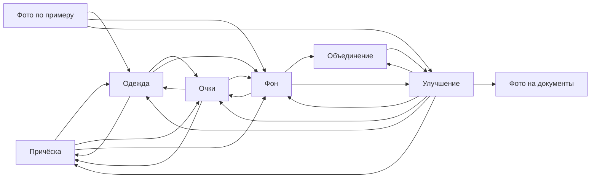
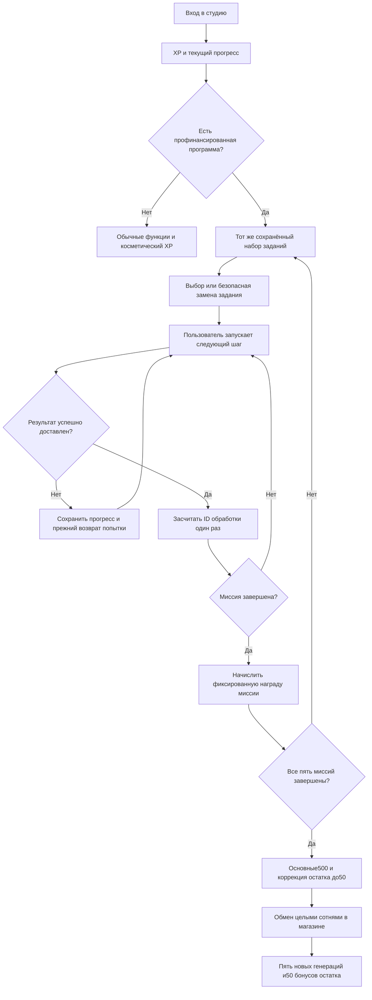

# «Образ»: граф функций и генератор программ заданий

24.10.2026. CR-GAMIFICATION-002. **Проект механики, без интеграции в бот и без начислений.** Дополняет [основное ТЗ](PRD.md) и заменяет прежнюю рекомендацию о разовом комбо150 и потолке10% как текущий вариант для обсуждения.

## 1. Новое условие владельца

Вся первая программа даёт **550 бонусов суммарно**: пять целых генераций по100 и остаток50 — половина стоимости следующей. Это не550 за каждое задание и не5 генераций после каждого шага. Пользователь видит общий прогресс, например: «Заработано350 из550», а также свой доступный остаток после обменов.

Сценариев можно составлять много, но число вариантов не увеличивает общий бюджет программы. Нужны **каталог функций, граф совместимости, шаблоны заданий и фиксированные места наград**. Генератор выбирает содержимое этих мест и сохраняет его один раз. Он не обращается к GPT ради выбора задания и не перебирает реальные платные обработки.

Первый ограниченный запуск предлагается для трёх основных бета-тестеров с уже выданными50 попытками. Нужен явный список участников/кампания, а не доступ любому человеку с ручным начислением. Это предложение области пилота; сами пользователи ещё не включены в программу.

## 2. Что означает «всегда остаётся половина»

Если общий заработок550 и обмен только кратен100, после получения пяти результатов останется50. Пользователь может обменивать по ходу программы: окончательный остаток по модулю100 всё равно будет50. Не требуется блокировать или прятать начисленные бонусы.

**При повторении возникает нюанс:** старые50 + новые550 =600, и после обмена шести генераций остаток станет0. Поэтому нельзя одновременно обещать550 в каждой новой программе и обязательный остаток50.

Предлагаемое правило для возможных будущих программ: основная сумма заданий всегда500, завершение доводит дробный остаток до50:

```text
r = бонусный остаток при входе в программу mod 100
добавка за завершение = (50 − r) mod 100
вся награда = 500 + добавка
```

При разрешённых здесь шагах по50 `r` бывает0 или50. Первая программа:500+50=550. Следующая при оставшихся50:500+0=500, после обмена ещё пяти снова остаётся50. Добавка и общий максимум заранее указаны на экране программы, не меняются задним числом.

Гарантия относится к **завершённой программе и обмену её целых наград**. Другие будущие источники бонусов могут изменить остаток; нельзя запрещать человеку использовать полностью заработанные100 ради красивого числа50. Внешние подарки сейчас выдаются генерациями и сами по себе не являются такими бонусами.

Повторные программы не открываются автоматически: для каждой нужен новый согласованный бюджет. Бесплатные ежедневные открытия и обработка наград не создают бесконечную следующую программу.

## 3. Граф совместимости функций

Это ориентированный граф: стрелка означает, что результат первой функции может стать исходником следующей. Он ограничивает допустимые цепочки, а не запускает их сам. Технические ключи сверены с текущим каталогом проекта.

| Узел | Что принимает/выдаёт | Дополнительное условие |
|---|---|---|
| `hair` — причёска | Портрет → портрет | В цепочке один вариант, не сетка разных лиц |
| `clothes` — одежда | Портрет → портрет | Одежда по выбору пользователя |
| `glasses` — очки | Портрет → портрет | В цепочке один вариант |
| `background` — фон | Портрет/группа → тот же тип | Подбираем фон к уже созданному образу |
| `enhance` — улучшение | Портрет/группа → тот же тип | Не обещаем устранение любых дефектов |
| `reference` — по примеру | Портрет + референс → портрет | Пользователь готов добавить пример; дополнительный анализ учитывается в стоимости |
| `merge` — объединение | Портрет + второй человек → группа | Нужна вторая фотография |
| `document` — документы | Портрет → лист снимков | Конечная ветка; принятие ведомством не обещается |

`document_original` без ИИ не входит в денежные задания. После листа документов не предлагаем менять очки на всём листе. После объединения группы нельзя автоматически назначать изменение причёски одного человека: для этого потребуется отдельный выбор адресата, которого в данном пилоте нет.

**Планируемая схема совместимости:**



Тип исходника проверяется дополнительно к стрелке. Например, после `merge→enhance` результат остаётся группой, поэтому продолжение в`hair` исключается. Метаданные результата и выбранный сценарий определяют тип; скрытый платный ИИ-анализ ради выдачи задания не требуется.

Циклы на схеме не создают бесконечных миссий: в одной миссии максимум3 шага, одинаковая функция внутри неё не повторяется. Между заданиями функция может повториться с другой целью и другим результатом, но один ID обработки не даёт награды дважды.

## 4. Программа из пяти мест

Сохраняем общий кошелёк наград, меняем конкретные функции, темы и формулировки. Пример базового набора:

| Место | Тип | Пример | Обработок | Бонусы |
|---|---|---|---:|---:|
| 1. Первый штрих | Одиночное | Примерить очки | 1 | 50 |
| 2. Собрать образ | Последовательное | Одежда → подходящий фон | 2 | 100 |
| 3. Смена настроения | Комбо | Причёска → очки | 2 | 100 |
| 4. Творческая серия | Три связанных действия | По примеру → одежда → фон | 3 | 100 |
| 5. Финальный сюжет | Три связанных действия | Фон → объединение → улучшение | 3 | 150 |
| **Основные задания** | | | **11** | **500** |
| Завершение программы | Коррекция остатка | В первой программе +50 | 0 | **50** |
| **Итого первая программа** | | | **11** | **550** |

Награды — за всё соответствующее задание. Они не прибавляются заново за каждое его действие. Вариант на100 может быть «улучшение → фон» вместо одежды; сумма и максимальная длина сохраняются. Референс/объединение не обязательны человеку, который не хочет загружать дополнительные фото: подбирается подходящая альтернатива того же места и награды.

Одиночные, парные и тройные задания помогают познакомиться с функциями. «Творческое» означает интересную тему и свободу выбора пользователя, а не оценку художественного качества нейросетью. Проверяется выполненный процесс: нужные функции, успешные результаты и связь исходников.

Пользователь сам запускает каждую обработку и видит списание. Генератор не может потратить три попытки одним незаметным нажатием. Результат каждого шага можно посмотреть до перехода к следующему.

## 5. Алгоритм комплектования

1. Проверить право на программу и наличие отдельного зарезервированного бюджета. Сохранить `campaign_id`, версию графа/наград и стартовый остаток бонусов.
2. Получить доступные возможности: обычное фото; согласие добавить референс/вторую фотографию; выбранные интересы. Не требовать данные о возрасте, поле или других характеристиках внешности ради задания.
3. Для каждого места подобрать пути нужной длины по графу, отфильтровав неподходящий тип исходника, повтор узла, отсутствующие дополнительные фото и превышение ограничения стоимости.
4. Ранжировать по разнообразию: меньше недавно использованных функций, другая тема, отсутствие идентичной цепочки в текущей программе. Разнообразие — предпочтение, не повод выдавать несовместимый путь.
5. Выбрать тему из проверенного каталога: деловой портрет, прогулка, путешествие и другие подготовленные владельцем темы. Текст составить из шаблона, не из скрытого произвольного промпта модели.
6. Зафиксировать выбранные цепочки, точные награды и максимум550. Обновление страницы возвращает тот же набор, а не новый источник заработка.
7. Предложить замену неинтересного задания до начала расхода. После начала можно менять лишь совместимое продолжение с сохранением уже засчитанных шагов и награды; иначе требуется понятное решение поддержки, без принуждения повторять платные шаги.
8. После каждого подтверждённого результата обновить прогресс. При завершении миссии единожды начислить её сумму; при последней — в той же транзакции добавить положенную коррекцию50/0.

Если вариантов не осталось, использовать заранее проверенную цепочку того же места. Если даже она недоступна — сохранить прогресс и показать причину. Нельзя молча заменить задание на более дорогое или снизить обещанную награду.

### Что даёт начальный граф

Выполнен локальный расчёт путей, без реальных пользователей и генераций:

| Доступные исходники | Одиночные | Пары | Тройки |
|---|---:|---:|---:|
| Одно фото человека | 6 | 16 | 33 |
| Также доступны референс и второй человек | 8 | 22 | 52 |

Таким образом, уже есть82 структурных пути при всех исходниках. Темы и распределение по пяти местам увеличивают число наборов. Это не82 гарантированно полезные идеи и не доказательство качества: формулировки/сочетания нужно проверить на бета-тесте. Не считать косметическую перестановку слов новой полезной миссией.

Подготовлены [пять демонстрационных программ в JSON](gamification-scenario-examples-2026-10-24.json): три разных первоначальных набора, один без дополнительных фото и пример следующей программы со стартовыми50. Это результат локального макета алгоритма; он не подключён к Telegram/MAX.

## 6. Поведенческий контур



Последний блок показывает первую программу или следующую со стартовыми50. Если у человека есть дополнительные старые целые бонусы, их нужно показать отдельно от награды этой программы. XP не конвертируется в денежные бонусы и не входит в550.

## 7. Экономика именно550 бонусов

| Стоимость результата | Пять готовых фото | Резерв на50 бонусов | Всё обязательство550 |
|---|---:|---:|---:|
| Наблюдаемая2,55635 ₽, малая выборка Image API | 12,78 ₽ | 1,28 ₽ | **14,06 ₽** |
| Плановая4 ₽ | 20 ₽ | 2 ₽ | **22 ₽** |
| Стресс6 ₽ | 30 ₽ | 3 ₽ | **33 ₽** |

Полгенерации не запускается в Image API отдельно. Это остаток бонусного права на будущий обмен. Все550 оцениваем как обязательство, хотя сразу человек сможет потратить только500.

**Три бета-тестера:**15 целых наград стоят60 ₽ по плану; оставшиеся3×50 бонусов требуют ещё6 ₽ резерва. Итого **66 ₽ сверх бюджета их150 тестовых попыток**. Совокупный план:600 ₽ исходные попытки +66 ₽ награды +300 ₽ один месяц общего VPS = **966 ₽**. Стресс-сценарий6 ₽:900+99+300=1299 ₽. Это план, не уже выполненное начисление и не фактический счёт.

Бета-награды финансирует владелец, выручка от этих выдач0. В платной программе первую550-награду учитывать отдельно от уже включённых в пакеты бонусов:

| Пакет | Цена | Включено результатов | Новая награда, эквивалент | Вклад при4 ₽ и резерве удержаний30% |
|---|---:|---:|---:|---:|
| Express | 240 ₽ | 20 | 5,5 | **66 ₽** |
| Базовый | 480 ₽ | 50 | 5,5 | **114 ₽** |
| Premium | 720 ₽ | 75 | 5,5 | **182 ₽** |

До аренды, другой бесплатной аудитории, рекламы и поддержки. При6 ₽ за результат вклад15 /3 /21 ₽ соответственно; запас почти исчезает. Поэтому готовность оплатить22 ₽ подарков не означает, что любые входные фотографии или модельные ошибки безопасны для всей экономики. Нужен контроль полной фактической стоимости по функциям. Фиксированной цели прибыли больше нет.

Прежний предел10% и ограничение20% вклада не совместимы с550 для каждого Express при прежних допущениях:22 ₽ — это25% его вклада88 ₽ до игры. Эти ограничения были предложением, а не принятым правилом; их нельзя скрыто применить и выдать меньше550. Для пилота нужен явный бюджет на всю обещанную награду.

## 8. Источники попыток и защита от повторов

- Для бета-версии подходят только отмеченные тестовые основные50, привязанные к этой программе. Прочие ручные выдачи автоматически права не дают.
- Для будущей платной программы подходят основные купленные единицы соответствующей покупки. Встроенные пакетные, регулярные, стартовые, канальные и обменянные награды не создают новых денежных наград. Они могут давать XP.
- Перенос существующего общего баланса к партиям происхождения — необходимая будущая доработка, а не готовая возможность текущей базы.
- Одна обработка принадлежит одному месту/шагу. Повтор вебхука, callback, доставки, входа или перегенерация уже завершённого шага не повторяет награду.
- Состояния кампании, награды и обмены хранить на сервере транзакционно. Ключ награды включает платформу, пользователя, кампанию и место; бонус за завершение имеет отдельный уникальный ключ.
- Не запускать кампанию бесконечно заново за её же подарки. Каждый следующий запуск требует нового источника финансирования и сохраняет остаток по явному правилу раздела2.
- Фото не сохранять дольше существующего TTL ради игры. Связи шагов должны восстанавливаться по безопасным метаданным/идентификатору сохранённого результата; иначе до запуска обещания изменить шаблон и объяснить ограничения.
- Telegram-диалог и Mini App одной платформы используют общий прогресс; MAX — ту же логику, но отдельную подтверждённую идентичность. Имя пользователя не служит ключом финансового учёта.

## 9. Приёмка будущей реализации

1. Первоначальная программа имеет5 мест и11 обработок, награды50+100+100+100+150=500; финальная добавка50; сумма550.
2. После обмена5 целых генераций остаётся50, в том числе при промежуточных обменах по100.
3. Следующая профинансированная программа при остатке50 выдаёт500 и после обмена ещё пяти сохраняет50; не выдаёт новые550 автоматически.
4. Повтор открытия возвращает прежние ID и прогресс; изменение текста/темы не даёт вторую награду.
5. Отсутствие второго фото/референса даёт совместимые альтернативы с теми же наградами; лист документов не попадает в портретную цепочку.
6. Нельзя дать одной обработке награды двух мест; неудача/повтор/бонусная обработка денежную награду не создают.
7. Лимит22 ₽ на участника при бюджете4 ₽ обеспечен заранее; повышение фактической стоимости останавливает новые предложения, а не отбирает уже заработанное.
8. Обмен не вызывает модель; пользователь явно запускает каждое фото. Тестирование генератора не делает платных вызовов.

**Готово сейчас:** граф, правила комплектования, пять мест, правила550/500/50, экономика и пять локальных JSON-примеров. **Не готово и не запускалось:** реальные игровые таблицы, UI, учёт происхождения, включение участников, денежные начисления и развёртывание игры. Следующий шаг — принять условия пилота и подготовить один сквозной сценарий; наборы расширять после обратной связи.

### Демонстрация магазина в чате

Подготовлены две интерактивные компоновки: «Витрина» с карточками1/3/5 и «Один выбор» с переключателем количества. В обоих вариантах демонстрационный баланс550, обмен500 с отдельным подтверждением увеличивает число генераций на5 и оставляет50 бонусов. Разделы «Задания» и «История» показывают получение и расход; демонстрацию можно начать с0бонусов и50основных попыток. XP показан отдельно и не покупает фото.

В браузере проверены открытие подтверждения, переход550→50 с увеличением39→44, а также выполнение первого демонстрационного задания:50→49основных попыток,+50бонусов,прогресс1/5. Эти числа принадлежат только макету. Дизайн адаптируется к светлой/тёмной теме; реальные API, аккаунты и списания не используются. Макет не включён в текущий Mini App.
